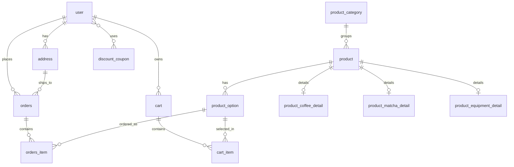

# Database Schema - CSI402 Final

Database engine: MySQL. ORM: Entity Framework Core with Pomelo MySQL provider.
Source: `CSI402_Final/Models/DB/Csi402FinalContext.cs`.

## Tables

### `user`

| Column | Type | Key | Notes |
| --- | --- | --- | --- |
| `userID` | varchar(36) | PK | User ID |
| `email` | varchar(254) | Unique | Login email |
| `password` | varchar(255) |  | Password hash/value |
| `phone` | varchar(20) |  | Phone number |
| `role` | varchar(20) |  | User role |
| `createdAt` | datetime |  | Created timestamp |

### `address`

| Column | Type | Key | Notes |
| --- | --- | --- | --- |
| `addressID` | varchar(36) | PK | Address ID |
| `userID` | varchar(36) | FK -> `user.userID` | Owner user |
| `fullName` | varchar(100) |  | Recipient full name |
| `phone` | varchar(20) |  | Recipient phone |
| `addressLine` | text |  | Street address |
| `district` | varchar(100) |  | District |
| `province` | varchar(100) |  | Province |
| `postalCode` | varchar(10) |  | Postal code |

### `product_category`

| Column | Type | Key | Notes |
| --- | --- | --- | --- |
| `categoryID` | varchar(36) | PK | Category ID |
| `categoryName` | varchar(50) | Unique | Category name |

### `product`

| Column | Type | Key | Notes |
| --- | --- | --- | --- |
| `productID` | varchar(36) | PK | Product ID |
| `categoryID` | varchar(36) | FK -> `product_category.categoryID` | Category |
| `productName` | varchar(150) |  | Product name |
| `productDescription` | text |  | Description |
| `productImage` | varchar(500) |  | Image path/URL |
| `productType` | varchar(20) |  | Product type |

### `product_option`

| Column | Type | Key | Notes |
| --- | --- | --- | --- |
| `productOptionID` | varchar(36) | PK | Option ID |
| `productID` | varchar(36) | FK -> `product.productID` | Product |
| `productUnit` | varchar(50) |  | Unit label |
| `productPrice` | decimal(10,2) |  | Price |
| `productStock` | int |  | Stock quantity |
| `productAmount` | int |  | Amount/size |

### `product_coffee_detail`

| Column | Type | Key | Notes |
| --- | --- | --- | --- |
| `productID` | varchar(36) | PK/FK -> `product.productID` | Coffee product |
| `origin` | varchar(100) |  | Origin |
| `process` | varchar(50) |  | Coffee process |
| `roastLevel` | varchar(50) |  | Roast level |
| `flavorNote` | varchar(100) |  | Flavor note |

### `product_matcha_detail`

| Column | Type | Key | Notes |
| --- | --- | --- | --- |
| `productID` | varchar(36) | PK/FK -> `product.productID` | Matcha product |
| `origin` | varchar(100) |  | Origin |
| `grade` | varchar(50) |  | Grade |
| `colorLevel` | varchar(50) |  | Color level |

### `product_equipment_detail`

| Column | Type | Key | Notes |
| --- | --- | --- | --- |
| `productID` | varchar(36) | PK/FK -> `product.productID` | Equipment product |
| `brand` | varchar(100) |  | Brand |
| `equipmentType` | varchar(100) |  | Equipment type |
| `material` | varchar(100) |  | Material |

### `cart`

| Column | Type | Key | Notes |
| --- | --- | --- | --- |
| `cartID` | varchar(36) | PK | Cart ID |
| `userId` | varchar(36) | FK -> `user.userID` | Cart owner |
| `cartStatus` | varchar(20) |  | Cart status |
| `createdAt` | datetime |  | Created timestamp |

### `cart_item`

| Column | Type | Key | Notes |
| --- | --- | --- | --- |
| `cartItemID` | varchar(36) | PK | Cart item ID |
| `cartID` | varchar(36) | FK -> `cart.cartID` | Parent cart |
| `productOptionID` | varchar(36) | FK -> `product_option.productOptionID` | Product option |
| `cartItemAmount` | int |  | Quantity |

### `orders`

| Column | Type | Key | Notes |
| --- | --- | --- | --- |
| `orderID` | varchar(36) | PK | Order ID |
| `userID` | varchar(36) | FK -> `user.userID` | Customer |
| `addressID` | varchar(36) | FK -> `address.addressID` | Shipping address |
| `shippingName` | varchar(100) |  | Recipient name |
| `shippingPhone` | varchar(20) |  | Recipient phone |
| `shippingAddress` | text |  | Snapshot address |
| `status` | varchar(20) |  | Order status |
| `totalPrice` | decimal(10,2) |  | Total price |
| `createdAt` | datetime |  | Created timestamp |

### `orders_item`

| Column | Type | Key | Notes |
| --- | --- | --- | --- |
| `orderItemID` | varchar(36) | PK | Order item ID |
| `orderID` | varchar(36) | FK -> `orders.orderID` | Parent order |
| `productOptionID` | varchar(36) | FK -> `product_option.productOptionID` | Product option |
| `amount` | int |  | Quantity |
| `price` | decimal(10,2) |  | Unit or line price |

### `discount_coupon`

| Column | Type | Key | Notes |
| --- | --- | --- | --- |
| `discountID` | varchar(36) | PK | Coupon ID |
| `discountCode` | varchar(36) | Unique | Coupon code |
| `discountName` | varchar(100) |  | Coupon name |
| `discountType` | varchar(10) |  | Discount type |
| `discountAmount` | decimal(10,2) |  | Discount amount/percent |
| `discountPrice` | decimal(10,2) |  | Discounted price/value |
| `discountLeft` | int |  | Remaining uses |
| `isActive` | bool |  | Active flag, default true |

### `discount_used`

Join table between `discount_coupon` and `user`.

| Column | Type | Key | Notes |
| --- | --- | --- | --- |
| `discountID` | varchar(36) | PK/FK -> `discount_coupon.discountID` | Coupon |
| `userID` | varchar(36) | PK/FK -> `user.userID` | User |

## Relationship Diagram

