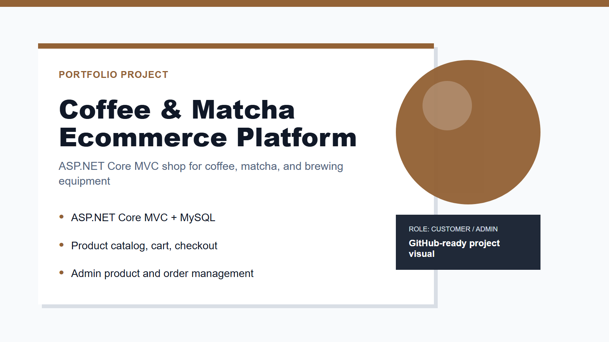
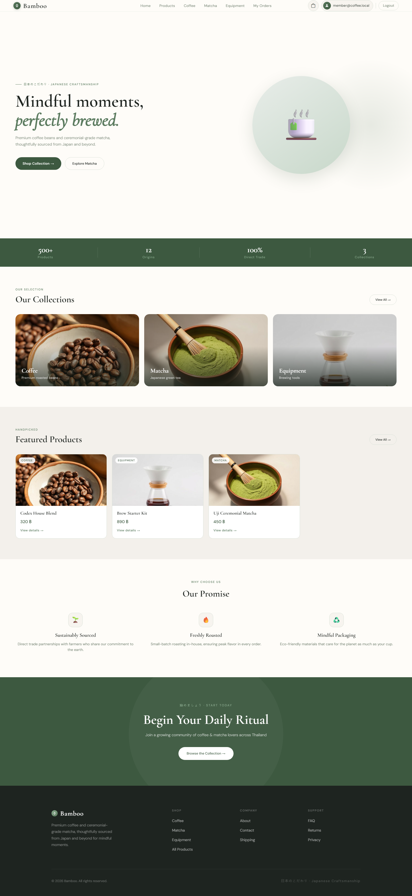
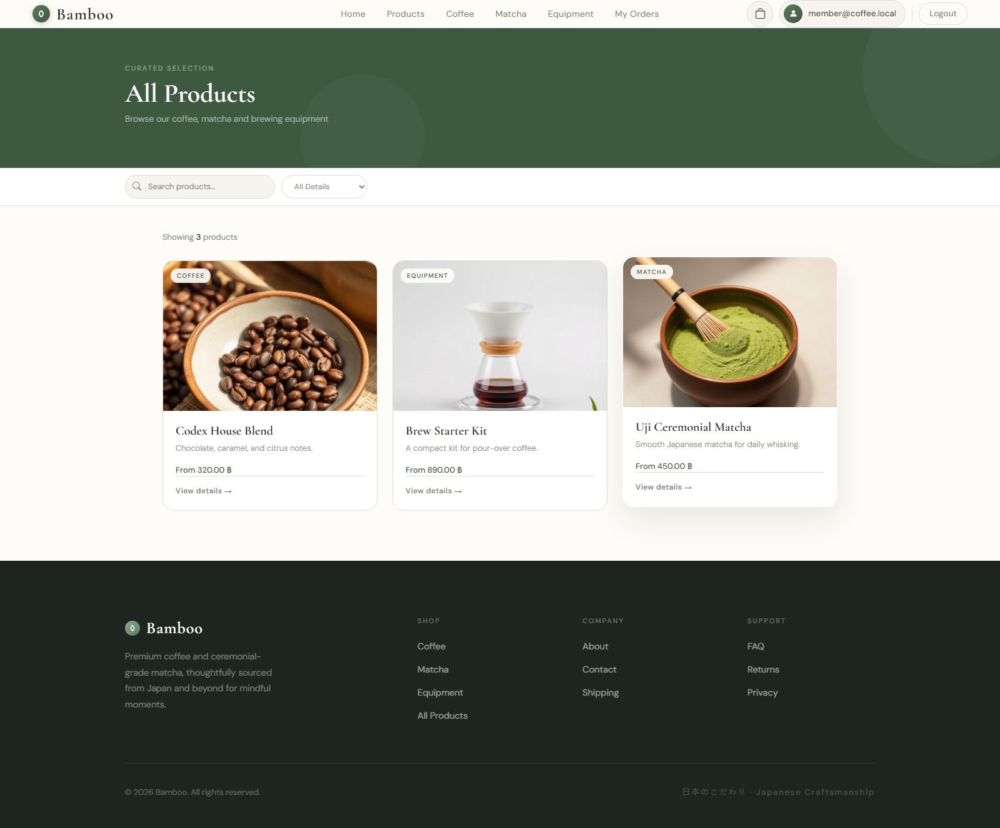
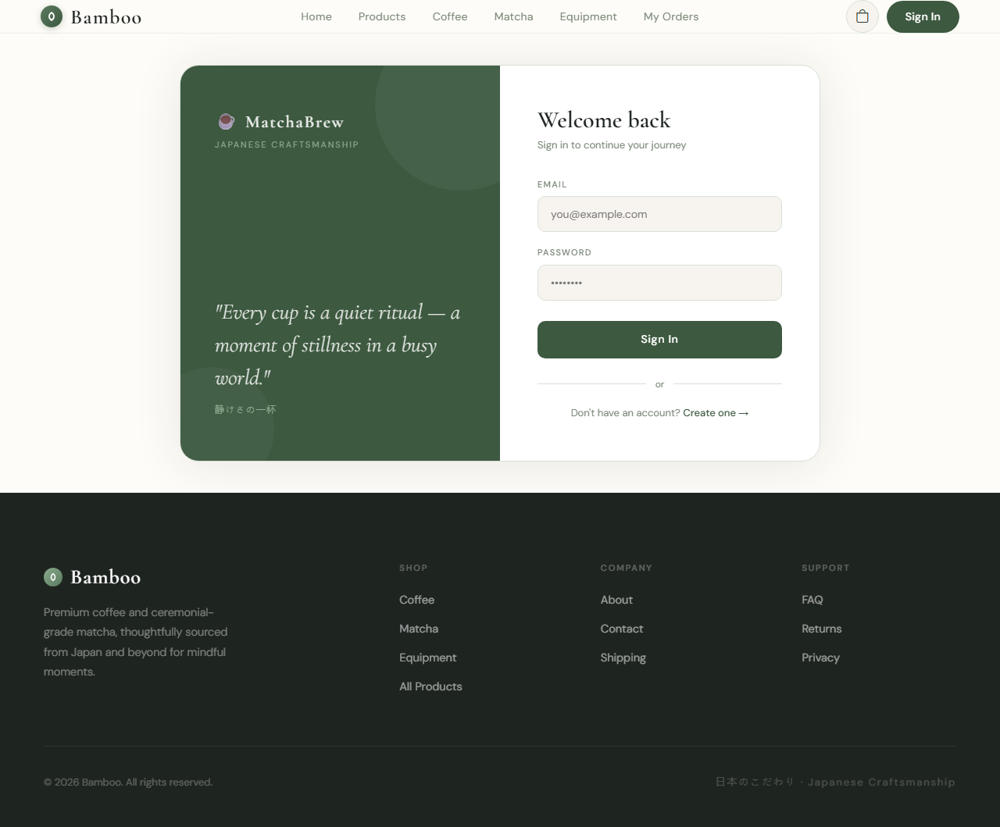

# Coffee & Matcha Ecommerce Platform

An ASP.NET Core MVC ecommerce project for selling coffee, matcha, and brewing equipment. It includes product browsing, product details, cart, checkout, order management, authentication, and an admin product area.

## Screenshots



### Customer and admin UI

| View | Preview |
| --- | --- |
| Customer home |  |
| Customer products |  |
| Customer login |  |
| Admin entry/login design |  |

### Actual runtime captures

The following images were captured from the running ASP.NET Core application after
creating a local MySQL schema and demo records. They are included to show the
customer and administrator flows beyond the design card.

| Area | Runtime screenshots |
| --- | --- |
| Public pages | [Home](docs/screenshots/roles/page-home.png) · [Products](docs/screenshots/roles/page-products.png) · [Product detail](docs/screenshots/roles/page-product-detail.png) · [Login](docs/screenshots/roles/page-login.png) · [Register](docs/screenshots/roles/page-register.png) · [Privacy](docs/screenshots/roles/page-privacy.png) |
| Customer | [Home](docs/screenshots/roles/role-customer-home.png) · [Products](docs/screenshots/roles/role-customer-products.png) · [Detail](docs/screenshots/roles/role-customer-detail.png) · [Cart](docs/screenshots/roles/role-customer-cart.png) · [Checkout](docs/screenshots/roles/role-customer-checkout.png) · [Order success](docs/screenshots/roles/role-customer-order-success.png) · [Order tracking](docs/screenshots/roles/role-customer-track.png) |
| Administrator | [Dashboard](docs/screenshots/roles/role-admin-dashboard.png) · [Products](docs/screenshots/roles/role-admin-products.png) · [Product detail](docs/screenshots/roles/role-admin-product-detail.png) · [Users](docs/screenshots/roles/role-admin-users.png) · [Orders](docs/screenshots/roles/role-admin-orders.png) · [Order detail](docs/screenshots/roles/role-admin-order-detail.png) · [Stock](docs/screenshots/roles/role-admin-stock.png) · [Coupons](docs/screenshots/roles/role-admin-coupons.png) |

<p align="center">
  
</p>

## Features

- ASP.NET Core MVC pages and controllers.
- MySQL database access through Entity Framework Core and Pomelo MySQL provider.
- Product catalog with category-specific detail tables for coffee, matcha, and equipment.
- Product options for unit, price, stock, and amount.
- User registration, login, cart, address, checkout, and order records.
- Admin product management and image upload to `wwwroot/uploads/products`.

## Tech Stack

| Layer | Technology |
| --- | --- |
| Backend/Web | ASP.NET Core MVC, C# |
| ORM | Entity Framework Core 9, Pomelo.EntityFrameworkCore.MySql |
| Database | MySQL |
| Frontend assets | Razor Views, Bootstrap, Tailwind build setup |

## Project Structure

```text
CSI402_Final/
  CSI402_Final.slnx
  CSI402_Final/
    Controllers/
    Models/
      DB/              # EF Core entities and DbContext
      ViewModels/
    Views/
    wwwroot/
```

## Prerequisites

- .NET SDK compatible with the project target framework (`net10.0`)
- MySQL Server
- Node.js/npm only if you need to rebuild frontend assets

## Database Configuration

Update `CSI402_Final/appsettings.json` before running locally, or set the `ConnectionStrings__DefaultConnection` environment variable:

```json
{
  "ConnectionStrings": {
    "DefaultConnection": "server=localhost;port=3306;database=csi402_final;user=root;password=your_password;"
  }
}
```

Do not commit real database passwords. The source uses a placeholder connection string. On first local start, the application creates the EF Core tables with `EnsureCreated`; it does not seed products or an admin account automatically.

## Run Locally

```bash
cd CSI402_Final/CSI402_Final
dotnet restore
dotnet run
```

If NuGet reports that no package source is configured, keep the included `CSI402_Final/NuGet.Config` file or run the restore from the `CSI402_Final` project directory. The project will create/update its EF Core schema when the application starts only if the database and connection string are available; this repository does not include a migration or seed-data command, so database initialization must be completed separately before production use.

Open the URL printed by ASP.NET Core.

## Database Schema

See `DATABASE_SCHEMA.md` for the MySQL table structure inferred from the EF Core context.
