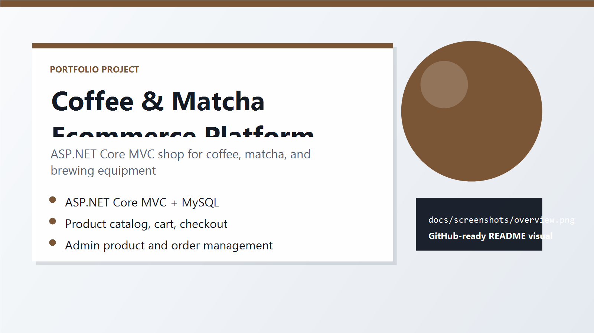

# Coffee & Matcha Ecommerce Platform

An ASP.NET Core MVC ecommerce project for selling coffee, matcha, and brewing equipment. It includes product browsing, product details, cart, checkout, order management, authentication, and an admin product area.

## Screenshots

<p align="center">
  
</p>

## Features

- ASP.NET Core MVC pages and controllers.
- MySQL database access through Entity Framework Core and Pomelo MySQL provider.
- Product catalog with category-specific detail tables for coffee, matcha, and equipment.
- Product options for unit, price, stock, and amount.
- User registration, login, cart, address, checkout, and order records.
- Admin product management and image upload to `wwwroot/uploads/products`.

## Tech Stack

| Layer | Technology |
| --- | --- |
| Backend/Web | ASP.NET Core MVC, C# |
| ORM | Entity Framework Core 9, Pomelo.EntityFrameworkCore.MySql |
| Database | MySQL |
| Frontend assets | Razor Views, Bootstrap, Tailwind build setup |

## Project Structure

```text
CSI402_Final/
  CSI402_Final.slnx
  CSI402_Final/
    Controllers/
    Models/
      DB/              # EF Core entities and DbContext
      ViewModels/
    Views/
    wwwroot/
```

## Prerequisites

- .NET SDK compatible with the project target framework (`net10.0`)
- MySQL Server
- Node.js/npm only if you need to rebuild frontend assets

## Database Configuration

Update `CSI402_Final/appsettings.json` before running locally:

```json
{
  "ConnectionStrings": {
    "DefaultConnection": "server=localhost;port=3306;database=csi402_final;user=root;password=your_password;"
  }
}
```

Do not commit real database passwords. The current source contains a local password in `appsettings.json` and a scaffolded fallback connection string in `Models/DB/Csi402FinalContext.cs`; replace those before publishing publicly.

## Run Locally

```bash
cd CSI402_Final/CSI402_Final
dotnet restore
dotnet run
```

Open the URL printed by ASP.NET Core.

## Database Schema

See `DATABASE_SCHEMA.md` for the MySQL table structure inferred from the EF Core context.
